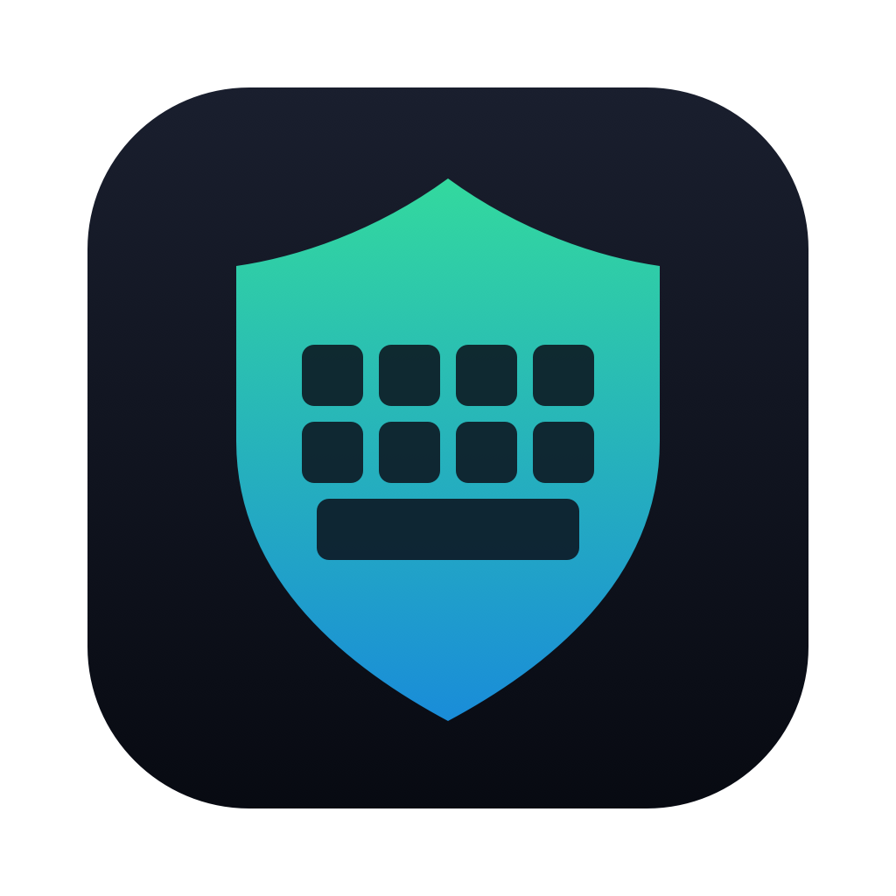
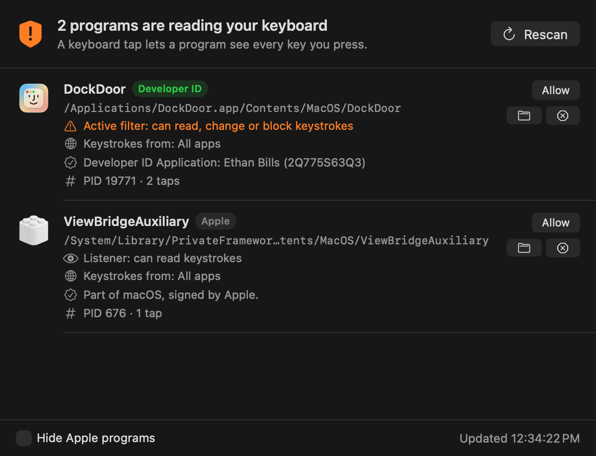
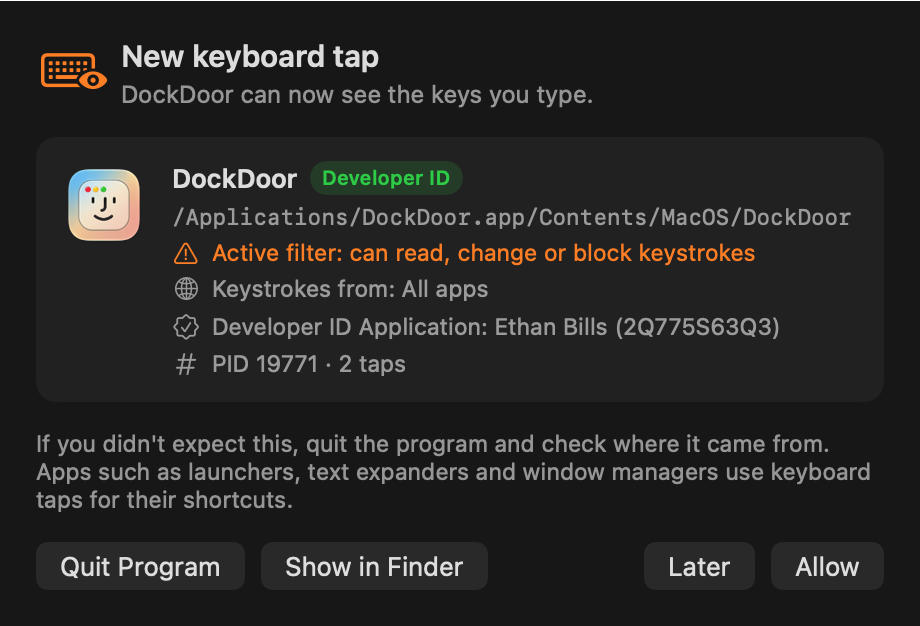

<p align="center">
  
</p>

<h1 align="center">TapWatch</h1>

<p align="center">
  See which programs can read your keyboard, and get alerted the moment a new one starts.<br>
  A small, native macOS menu bar app that watches for keyboard event taps.
</p>

<p align="center">
  
  
  
  
</p>

<p align="center">
  
</p>

## Why

On macOS, any program can ask the window server for a **keyboard event tap**: a hook that receives every key you press, in every app. Launchers, text expanders and window managers use taps for their shortcuts. Keyloggers and other malware use them to capture passwords and messages.

macOS doesn't show you who holds a tap. TapWatch does.

## Features

- **Lists every program reading the keyboard,** with its name, icon, path and process ID.
- **Shows what each tap can do.** A *listener* can only read keystrokes. An *active filter* can also change or block them.
- **Shows where the keystrokes come from:** all apps, or one named app.
- **Checks code signatures** and labels each program *Apple*, *App Store*, *Developer ID* (with the developer's name and team ID), *Ad hoc*, *Unsigned* or *Invalid signature*.
- **Alerts you as soon as a new tap appears.** It listens for the system's "event tap added" notification, so there's no polling delay.
- **Ignores short-lived taps,** such as those a VM or screen-sharing session creates for a split second. A tap has to stay for a second before you're alerted.
- **One-click actions:** *Allow* to stop future alerts for that program, *Show in Finder*, or *Quit Program*.
- **Menu bar status:** a check-mark shield when there's nothing to review, an exclamation-mark shield when a program you haven't allowed is reading the keyboard, and a crossed-out shield while alerts are paused.
- **Hide Apple programs** (on by default) keeps built-in macOS services out of the way.
- **Open at login, pause alerts,** and manage your allowed programs in Settings.
- **No permissions, no network, no helpers.** TapWatch doesn't need Accessibility or Input Monitoring access, never reads your keystrokes, and nothing leaves your Mac.

<p align="center">
  
</p>

## Install

TapWatch builds with the Swift compiler from Apple's Command Line Tools, so you don't need Xcode.

```bash
xcode-select --install          # only if you don't have the Command Line Tools yet
git clone https://github.com/adamly218/TapWatch.git
cd TapWatch
./build.sh --install            # builds a universal app and copies it to /Applications
```

Run `./build.sh` without `--install` to build only `build/TapWatch.app`.

On first launch TapWatch opens the **Keyboard Taps** window so you can review what's already running. After that it stays in the menu bar. Open the app again from Applications to bring the window back.

### Command line

```bash
# Print every keyboard tap and exit
build/TapWatch.app/Contents/MacOS/TapWatch --scan
```

```
DockDoor  [Developer ID, team 2Q775S63Q3]
  path    /Applications/DockDoor.app/Contents/MacOS/DockDoor
  pid     19771, 2 tap(s): 29747667, 303022407
  access  Active filter: can read, change or block keystrokes
  scope   All apps
  signer  Developer ID Application: Ethan Bills (2Q775S63Q3)
```

`--snapshot <folder>` renders the window and an alert to PNG files. The screenshots in this README were made with it.

## How it works

| Step | How |
| --- | --- |
| Find taps | `CGGetEventTapList` returns every event tap on the system. TapWatch keeps the enabled ones that receive key-down or key-up events. |
| Identify the owner | `proc_pidpath` gives the program's path. The enclosing `.app` bundle supplies the name and icon. |
| Check the signature | `SecStaticCodeCheckValidity` against code requirements for Apple, Mac App Store and Developer ID. The signing certificate gives the developer's name. |
| Notice new taps | `notify_register_dispatch` on `com.apple.coregraphics.eventTapAdded` and `…eventTapRemoved`, plus a re-check every 10 seconds to catch taps that get enabled later. |

### Project layout

```
Sources/
  Taps.swift      tap enumeration, process lookup, code-signature checks
  Watcher.swift   live monitoring and preferences
  Views.swift     SwiftUI window, alert and Settings
  main.swift      menu bar item, windows, actions, command-line modes
icon/             app icon generator (swift icon/make-icon.swift)
build.sh          build, sign and optionally install
```

## FAQ

**Something I trust shows up. Is that bad?**
Usually not. Window managers, clipboard tools, launchers, text expanders and remapping tools all need keyboard taps. Click **Allow** and TapWatch won't alert about that program again. Be suspicious of programs you don't recognise, ones that are *Unsigned* or have an *Invalid signature*, and anything running from a temporary or hidden folder.

**A program's tap was created, but TapWatch didn't alert.**
macOS keeps a new tap disabled until you grant the program Input Monitoring or Accessibility access, and a disabled tap can't read anything. TapWatch alerts once the tap is enabled, within about 10 seconds.

**Does TapWatch catch every keylogger?**
No. TapWatch covers event taps, the most common way a program reads keystrokes. Software can also read input through the HID system with Input Monitoring access, through Accessibility APIs, or through drivers. Check **System Settings → Privacy & Security → Input Monitoring** and **Accessibility** as well.

**The menu bar icon doesn't appear.**
Newer versions of macOS make apps ask before they can show menu bar items. Open **System Settings → Menu Bar** and turn **TapWatch** on.

**How do I remove it?**
Quit TapWatch from its menu and delete `/Applications/TapWatch.app`.

## License

[MIT](LICENSE) © 2026 adamly218
